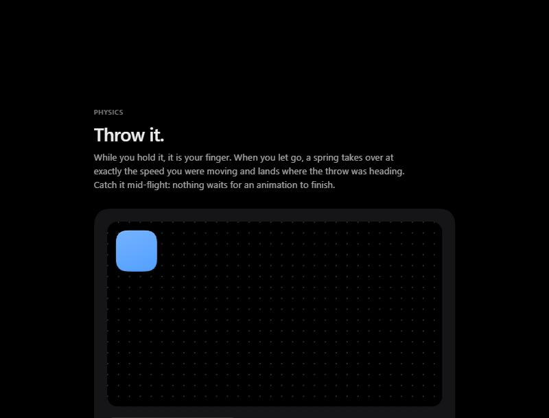
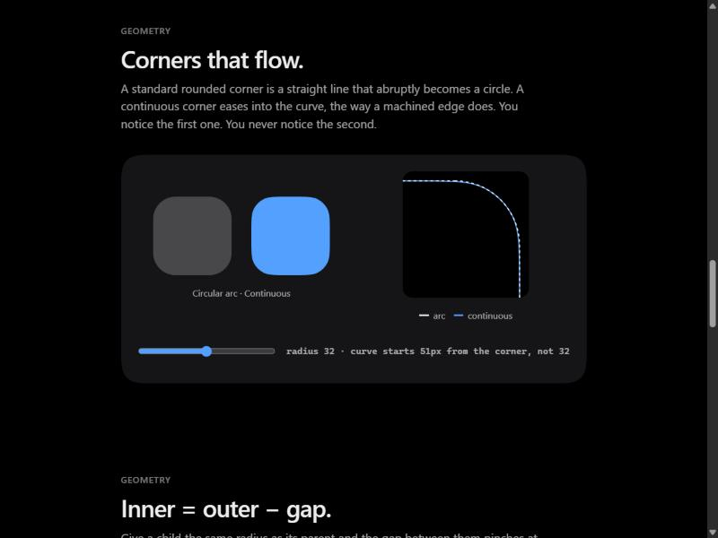
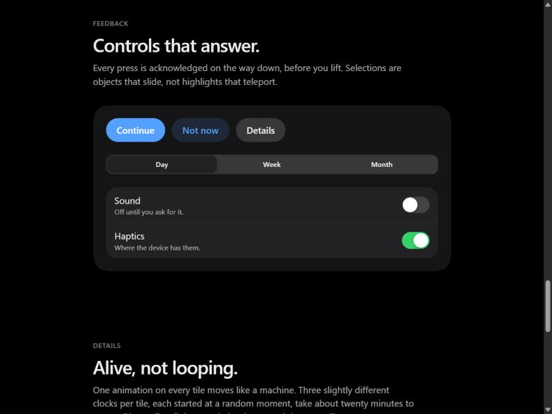

# Second Nature

**An agent skill for interfaces people stop noticing.**

AI agents can build an interface that works. This skill teaches them to build one that feels *made*: nothing on screen that does not need to be there, motion that behaves like a real object, corners that flow, every touch answered, and no moment of lag. It distils the craft behind Apple's platforms into rules with reasons, the numbers behind them, and working code, for any stack and any kind of product.

<p>
  
  
  
</p>

Use it for websites, landing pages and portfolios, web apps and dashboards, iOS / macOS / watchOS / visionOS / tvOS apps, React Native, Flutter and Android, desktop software, operating-system shells, console and TV interfaces, and game menus and HUDs.

## The eight pillars

| | Pillar | The question it asks |
| --- | --- | --- |
| 1 | **Simplicity** | What here does the person not need right now? |
| 2 | **Physics** | Does it move the way a real object would if I did that to it? |
| 3 | **Geometry** | Are the shapes, spacing and alignment decided by a system, or by accident? |
| 4 | **Feedback** | Does every action get an immediate, proportionate answer? |
| 5 | **Consistency** | Does the same thing look and behave the same everywhere? |
| 6 | **Cognition** | How much does the person have to remember, decide or decode? |
| 7 | **Details** | Would the smallest part of this survive being looked at closely? |
| 8 | **Performance** | Is there any moment where the person waits and nothing tells them why? |

It is about principles, not costume. The skill tells agents to keep your brand, your design system and your platform's conventions, and to apply this level of care inside them, rather than making everything look like an Apple product.

## Install

**Any agent that supports skills** (Claude Code, Cursor, Codex and others), with the [skills CLI](https://skills.sh):

```bash
npx skills@latest add nirmalkcse/second-nature
```

**Claude Code, as a plugin:**

```bash
claude plugin marketplace add nirmalkcse/second-nature
```

```bash
claude plugin install second-nature@second-nature
```

**By hand:** copy the `skills/second-nature` folder into `~/.claude/skills/` (for you) or `.claude/skills/` in a project (for your team). For Claude on the web or desktop, zip that folder and upload it as a custom skill.

While this repository is private, the first two methods need your git credentials to have access to it.

## Use it

The skill triggers on its own for interface work. You can also ask for it by name:

- *"Build the pricing page. Use second-nature."*
- *"This bottom sheet feels stiff. Make it feel native."*
- *"Review `src/components` against second-nature and fix what feels cheap."*
- *"Design the settings screen for the iPad app."*
- *"Give me a spring for the drawer that matches the SwiftUI one."*

## Try it

Open [`demo/index.html`](demo/index.html) in a browser (double-click it, no server needed). Throw the tile and catch it mid-flight, pull the sheet past its end, flick the slider, compare the corners, and switch the jiggle between *organic* and *in step*. Everything on the page is built from the skill's own files.

## What is inside

```
skills/second-nature/
├── SKILL.md                    The loop, the decision rules, the numbers, the tells
├── references/
│   ├── simplicity.md           Subtraction, empty space, progressive disclosure, words
│   ├── motion.md               Springs, curves, choreography, idle motion, reduced motion
│   ├── gestures.md             Tracking, rubber-banding, momentum, deciding on intent
│   ├── geometry.md             Continuous corners, concentricity, spacing, optical alignment
│   ├── feedback.md             States, press anatomy, haptics, sound, waiting, calm readouts
│   ├── consistency.md          Tokens, components, one motion language, platform conventions
│   ├── cognition.md            The psychology, wayfinding, memory, attention, every screen size
│   ├── details.md              Six iOS behaviours taken apart, and a catalogue of small things
│   ├── performance.md          Budgets, the frame pipeline, perceived speed, measuring
│   ├── typography-color.md     System fonts, sizes, tracking, semantic colour, icons
│   ├── materials-depth.md      Layers, Liquid Glass and its rules, translucency, shadow
│   ├── review.md               How to audit an interface and report it
│   ├── apple-lineage.md        Design eras, OS releases, the source talks, confidence notes
│   └── platforms/
│       ├── web.md
│       ├── apple.md
│       ├── cross-platform.md   React Native, Flutter, Android, Windows, desktop shells
│       └── games-consoles-os.md
├── assets/
│   ├── tokens.css              Space, radius, type, semantic colour, depth, materials, motion
│   ├── base.css                The web foundation plus reference components
│   ├── physics.js              Springs, momentum, rubber-banding, drag, intent, jiggle
│   ├── squircle.js             Continuous-corner and superellipse paths
│   ├── feedback.js             Haptics, synthesised sound, gamepad rumble
│   └── SecondNature.swift      The same vocabulary for SwiftUI
├── scripts/
│   ├── spring.mjs              One spring in every platform's dialect
│   └── audit.mjs               Finds the tells a machine can find
└── evals/                      Three test tasks with 52 checks, for benchmarking the skill
```

### The two scripts

Convert a spring once and paste it anywhere:

```bash
node skills/second-nature/scripts/spring.mjs --duration 0.4 --bounce 0.2
```

It prints the physical parameters, how long it really takes to settle, and ready-to-use code for CSS, Motion, SwiftUI, UIKit, Core Animation, Reanimated, Compose and Flutter.

Scan a codebase for the things that make an interface feel unfinished:

```bash
node skills/second-nature/scripts/audit.mjs path/to/your/src
```

It reports each finding with the file and line, why it matters and how to fix it: `transition: all`, ease-in, entering from `scale(0)`, animated layout properties, hover styles that stick on touch, `100vh`, inputs that zoom the page, disabled zoom, removed focus rings, missing reduced-motion handling, click handlers on `div`s, scroll hijacking, and more. Add `--json` for tooling or `--strict` for CI.

Both are plain Node with no dependencies.

## What is verified, and what is not

- `physics.js`: 17 tests, including Apple's documented spring values, agreement between the closed-form solver and brute-force integration, and the published rubber-band figures. Run `npm test`.
- `audit.mjs`: 6 tests against deliberately bad and deliberately good samples; the skill's own assets and demo pass it.
- The demo: the drag, throw, catch-mid-flight, rubber-band, snap and commit-on-projection logic was exercised in a browser with simulated pointer input, and the layout checked at desktop and phone widths in light and dark. It has not been felt on a physical phone.
- A with-and-without benchmark on three web tasks (Claude Fable 5.2, one run each): both versions passed all 52 checks, so the skill did not raise the pass rate. With it, every result gained a designed dark mode, contrast handling, continuous corners and a token system, at about 1.8 times the tokens. Details and comparison images: [`benchmark/RESULTS.md`](benchmark/RESULTS.md).
- `SecondNature.swift`: written against the public SwiftUI API but **not compiled** in this repository. Build it in your project before relying on it.
- Feel on real hardware, haptics, and 120 Hz behaviour cannot be verified from a repository. The skill tells agents to say so.

## Where it comes from

- Apple's [Human Interface Guidelines](https://developer.apple.com/design/human-interface-guidelines/) and WWDC design sessions, chiefly *Designing Fluid Interfaces* (2018), *Animate with Springs* (2023), *Meet Liquid Glass* (2025) and *Principles of Great Design* (2026).
- [Emil Kowalski's skills](https://github.com/emilkowalski/skills) and writing on web animation, which shaped the approach to motion.
- Independent teardowns of iOS by [@justinbuilds.mov](https://www.instagram.com/justinbuilds.mov/) (the gesture, jiggle and battery-display specifics) and a whitespace study by [@creative_vaani](https://www.instagram.com/creative_vaani/).
- Figma's write-up on continuous corners, Nielsen's response-time limits, and the standard literature on usability and game feel.

[`references/apple-lineage.md`](skills/second-nature/references/apple-lineage.md) lists the sources in full and says which numbers are documented, which are widely established, which come from reverse-engineering, and which were derived for this skill.

## Notes

Not affiliated with, endorsed by or sponsored by Apple Inc. Apple, iOS, macOS, SwiftUI, San Francisco, SF Symbols and Liquid Glass are trademarks of Apple Inc., used here only to describe their design guidance. The San Francisco fonts and SF Symbols are licensed for use on Apple platforms; this skill does not include them and tells agents not to ship them elsewhere.

MIT licensed. See [LICENSE](LICENSE).
