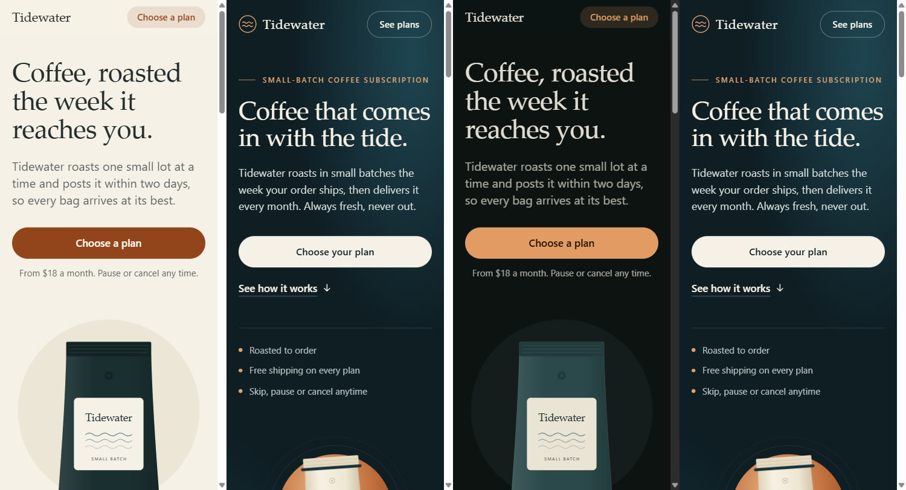
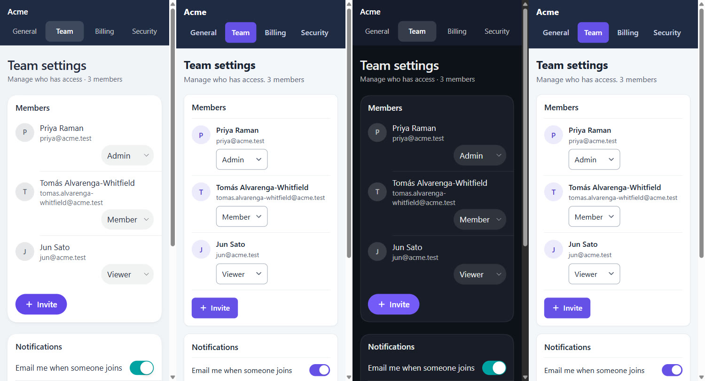

# Benchmark: does the skill change the result?

12 November 2026 · three tasks · one run per configuration · model: Claude Fable 5.2 throughout.

## Result

**On these tasks the skill did not change the pass rate, and it costs more. After a trim, it costs about a third more tokens than working with no skill, down from nearly double.**

| | No skill | Skill, first version | Skill, trimmed (current) |
| --- | --- | --- | --- |
| Checks passed | 52 of 52 | 52 of 52 | 52 of 52 |
| Tokens per task (average) | 184,000 | 333,000 | 243,000 |
| Time per task (average) | 20 min | 29 min | 24 min |
| Tokens, against no skill | | 1.8 times | 1.3 times |

The baseline is the same top-tier model with no skill. Given a clear brief ("premium", "has to work well on a phone", "feel native"), it already produced accessible, phone-ready, interruptible work that passed every check.

## What the skill did change

These are descriptions of what each result contains, not grades. They compare the first version of the skill with no skill.

| | Landing page | Player sheet | Settings fix |
| --- | --- | --- | --- |
| | with / without | with / without | with / without |
| Designed dark mode | yes / no | yes / no | yes / no |
| Increased-contrast handling | yes / no | yes / no | yes / no |
| Reduced-transparency handling | yes / no | yes / no | no / no |
| Continuous corners | yes / no | yes / no | yes / no |
| Spring motion | yes / no | yes / yes | yes / no |
| Design tokens | 83 / 24 | 58 / 22 | 78 / 19 |
| Distinct accent hues | 1 / 3 | 1 / 0 | 3 / 3 |
| Background inert under overlays | n/a | yes / no | yes / yes |
| Text selection disabled page-wide | no / no | no / yes | no / no |

In short: with the skill, every result follows the device's light or dark setting, honours the contrast setting, is built on a token system, and uses softer geometry. Without it, none has a dark mode, and one disables text selection for the whole page.

*Correction: an earlier version of this table gave the settings fix as "yes / no" on the inert row. Both settings pages use a native modal dialog, which makes the page behind it inert. The comparison script had counted the word "inert" in a code comment.*

Visually, the two landing pages have different characters. With the skill it is light, sparse and single-accent. Without it, it is a dark, more illustrated hero with two calls to action and a feature list. Both read as premium; which is better is a matter of taste. The comparison images are in this folder.

| | |
| --- | --- |
| Landing page, desktop |  |
| Landing page, phone (light, then dark setting) |  |
| Player sheet, collapsed and open |  |
| Settings fix, phone (light, then dark setting) |  |
| Settings fix, desktop |  |

In every image the result made with the first version of the skill is on the left, and the result made without it is on the right.

## The trim

In the first version, the skill's entry file pointed to a reference file for each topic, and the agents opened most of them. Counting from the transcripts, the player-sheet run opened 21 of the skill's files (13 of them references) and the settings run 16 (12 references): about 4,700 and 3,400 lines if each was read in full. That reading is where the extra tokens went.

The trimmed entry file says what to read for each kind of task (for a single page: nothing more), caps reading at three references, and carries the essentials itself: a short floor of rules for any interface, and a summary of the bundled code so it can be used without being opened. The reference files are unchanged.

The same three tasks were then run again with the trimmed skill, with identical prompts.

| Task | No skill | Skill, first version | Skill, trimmed |
| --- | --- | --- | --- |
| Landing page | 167,000 tokens · 17 min | 312,000 · 25 min | 221,000 · 22 min |
| Player sheet | 236,000 · 27 min | 367,000 · 34 min | 299,000 · 29 min |
| Settings fix | 149,000 · 15 min | 321,000 · 27 min | 210,000 · 20 min |
| **Average** | **184,000 · 20 min** | **333,000 · 29 min** | **243,000 · 24 min** |

Against the first version, the trimmed skill used 27% fewer tokens and 18% less time, and still passed all 52 checks.

What the results contain, trimmed against first version:

| | Landing page | Player sheet | Settings fix |
| --- | --- | --- | --- |
| | trimmed / first | trimmed / first | trimmed / first |
| Dark mode, reduced motion, increased contrast | yes / yes | yes / yes | yes / yes |
| Reduced-transparency handling | yes / yes | yes / yes | yes / no |
| Continuous corners, spring motion | yes / yes | yes / yes | yes / yes |
| Design tokens | 75 / 83 | 56 / 58 | 67 / 78 |
| Pressed-state rules | 14 / 6 | 12 / 4 | 10 / 8 |
| Distinct accent hues | 2 / 1 | 1 / 1 | 3 / 3 |
| Haptics where available | no / no | no / yes | no / no |
| Audit findings | none / none | none / none | none / none |

The trimmed runs kept everything the first version added over no skill. The differences are small and go both ways: more pressed states and one more page that handles reduced transparency; slightly fewer tokens and no vibration on the player sheet.

One difference the checks do not cover: the landing page's email form has no address to send to in either version. The first version tells the visitor so ("Preview only: this form is not connected yet, so nothing was sent"). The trimmed version shows the visitor a confirmation and only logs a console warning; the agent disclosed this in its report. The skill has no rule about this in either version, so this is more likely run-to-run variation than an effect of the trim.

## The tasks

1. **premium-landing-page** — build a landing page for a coffee subscription (hero, three steps, three plans with a monthly/annual switch, FAQ, email signup). 14 checks.
2. **mobile-player-sheet** — build a draggable "now playing" bottom sheet for a mobile web music app. 18 checks.
3. **fix-cheap-settings-page** — repair a deliberately flawed team-settings page without changing its features. 20 checks.

The prompts and checks are in `skills/second-nature/evals/`.

## How it was measured

- Each result was loaded in Chromium at 375 × 812 with touch emulation. Behaviour was tested directly: dragging and flicking the sheet, catching it mid-animation, pulling it past its limits, operating dialogs and switches, measuring tap-target sizes and text contrast.
- Every measurement was taken at 60 frames per second, checked before and after.
- Static checks cover reduced motion, focus visibility, pressed states, hover gating and motion properties.

## Read this before drawing conclusions

- **One run per configuration.** Differences of this size could partly be run-to-run variation. The token saving from the trim appears on all three tasks (19% to 35%), which makes it less likely to be chance, but it is still three runs.
- **The checks cannot separate the configurations.** All 52 pass in all three, so they measure a floor that the baseline already clears.
- **The checks were written by the skill's author**, before the runs, and four of them reuse the skill's own audit script. During grading, one audit rule turned out to be a false positive against the no-skill settings page (it flagged `100vh` written as a fallback directly before `100dvh`). The rule was fixed; before the fix that page scored 19 of 20.
- **Times are softer than token counts.** Three first-round runs were interrupted by a usage limit and resumed; their times are active time taken from the transcripts and may include waiting. The trimmed runs were not interrupted.
- **What the trimmed runs read was not recorded.** Their transcripts were not kept, so the report can say they spent less, but not which files they opened.
- **Web only.** All three tasks were single-file web pages. Nothing here says anything about native apps, games or larger codebases.
- **Feel on a real phone was not tested**, by either the agents or the benchmark.

## What this suggests

- For a top-tier model with a specific brief, the skill's main effect is on character and system-adaptiveness (dark mode, contrast, tokens, restraint), not on correctness.
- That effect survived the trim, so on tasks of this size it comes from the entry file, not from the reference files.
- The remaining overhead, about a third more tokens, is the price of that effect here. Whether it is worth paying depends on whether those properties matter to the product.
- Where the skill may matter more, untested: smaller or faster models, vaguer briefs, review tasks, native platforms, and keeping many screens consistent.
