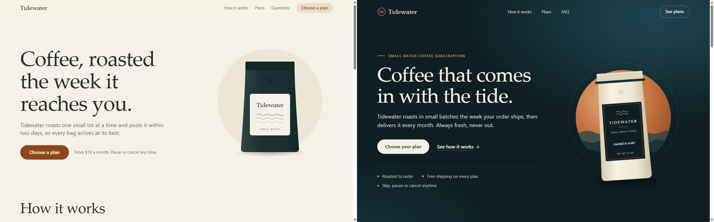
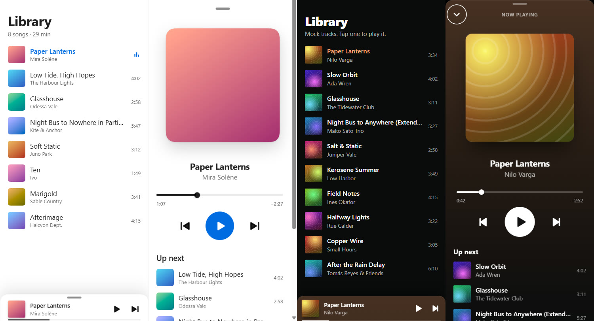
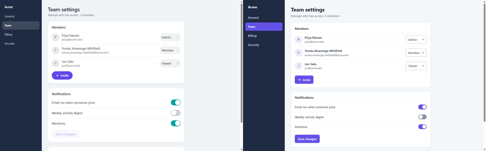

# Benchmark: does the skill change the result?

12 November 2026 · three tasks · one run each with the skill and without · model: Claude Fable 5.2 for both.

## Result

**On these tasks the skill did not change the pass rate, and it cost more.**

| | With skill | Without skill |
| --- | --- | --- |
| Checks passed | 52 of 52 | 52 of 52 |
| Tokens per task (average) | 333,000 | 184,000 |
| Time per task (average) | 29 min | 20 min |

The baseline is the same top-tier model with no skill. Given a clear brief ("premium", "has to work well on a phone", "feel native"), it already produced accessible, phone-ready, interruptible work that passed every check. With the skill the runs used about 1.8 times the tokens and 1.5 times the time.

## What the skill did change

These are descriptions of what each result contains, not grades.

| | Landing page | Player sheet | Settings fix |
| --- | --- | --- | --- |
| | with / without | with / without | with / without |
| Designed dark mode | yes / no | yes / no | yes / no |
| Increased-contrast handling | yes / no | yes / no | yes / no |
| Reduced-transparency handling | yes / no | yes / no | no / no |
| Continuous corners | yes / no | yes / no | yes / no |
| Spring motion | yes / no | yes / yes | yes / no |
| Design tokens | 83 / 24 | 58 / 22 | 78 / 19 |
| Distinct accent hues | 1 / 3 | 1 / 0 | 3 / 3 |
| Background inert under overlays | n/a | yes / no | yes / no |
| Text selection disabled page-wide | no / no | no / yes | no / no |

In short: with the skill, every result follows the device's light or dark setting, honours the contrast setting, is built on a token system, and uses softer geometry and one accent. Without it, none has a dark mode, and one disables text selection for the whole page.

Visually, the two landing pages have different characters. With the skill it is light, sparse and single-accent. Without it, it is a dark, more illustrated hero with two calls to action and a feature list. Both read as premium; which is better is a matter of taste. The comparison images are in this folder.

| | |
| --- | --- |
| Landing page, desktop |  |
| Landing page, phone (light, then dark setting) |  |
| Player sheet, collapsed and open |  |
| Settings fix, phone (light, then dark setting) |  |
| Settings fix, desktop |  |

In every image the result made with the skill is on the left.

## The tasks

1. **premium-landing-page** — build a landing page for a coffee subscription (hero, three steps, three plans with a monthly/annual switch, FAQ, email signup). 14 checks.
2. **mobile-player-sheet** — build a draggable "now playing" bottom sheet for a mobile web music app. 18 checks.
3. **fix-cheap-settings-page** — repair a deliberately flawed team-settings page without changing its features. 20 checks.

The prompts and checks are in `skills/second-nature/evals/`.

## How it was measured

- Each result was loaded in Chromium at 375 × 812 with touch emulation. Behaviour was tested directly: dragging and flicking the sheet, catching it mid-animation, pulling it past its limits, operating dialogs and switches, measuring tap-target sizes and text contrast.
- Every measurement was taken at 60 frames per second, checked before and after.
- Static checks cover reduced motion, focus visibility, pressed states, hover gating and motion properties.

## Read this before drawing conclusions

- **One run per configuration.** Time and token differences of this size could partly be run-to-run variation.
- **The checks cannot separate the two.** All 52 pass on both sides, so they measure a floor that the baseline already clears.
- **The checks were written by the skill's author**, before the runs, and four of them reuse the skill's own audit script. During grading, one audit rule turned out to be a false positive against the no-skill settings page (it flagged `100vh` written as a fallback directly before `100dvh`). The rule was fixed; before the fix that page scored 19 of 20.
- **Three runs were interrupted by a usage limit and resumed.** Their times are active time taken from the transcripts and may include waiting.
- **Web only.** All three tasks were single-file web pages. Nothing here says anything about native apps, games or larger codebases.
- **Feel on a real phone was not tested**, by either the agents or the benchmark.

## What this suggests

- For a top-tier model with a specific brief, the skill's main effect is on character and system-adaptiveness (dark mode, contrast, tokens, restraint), not on correctness.
- Where it may matter more, untested: smaller or faster models, vaguer briefs, review tasks, native platforms, and keeping many screens consistent.
- The token overhead comes mostly from reading reference files. Trimming what the skill tells agents to read for small tasks is the obvious way to reduce it.
